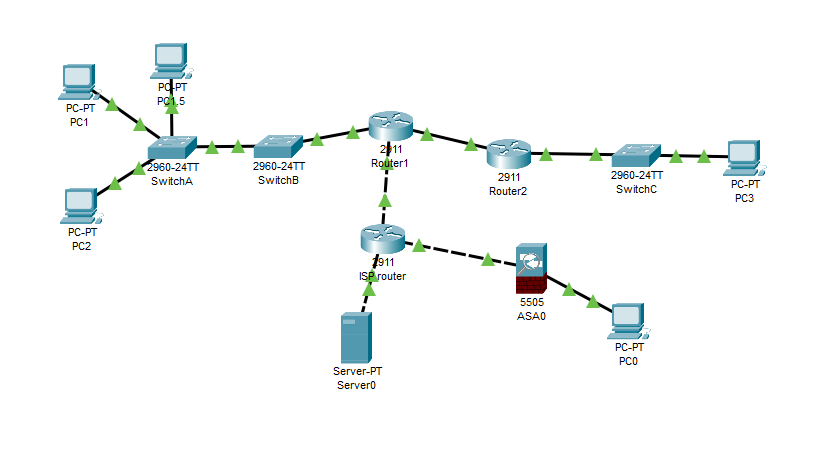

# LAB 04 — Cisco ASA 5505 Enterprise Firewall Fundamentals

**Environment:** Cisco Packet Tracer  
**Device:** Cisco ASA 5505 (ASA 8.4(2) in the simulation)  
**Status:** Partially completed — internal reachability confirmed; external reachability unresolved

## 1. Objective

Extend the enterprise topology built in LAB 01–03 by adding a dedicated firewall segment. Practice ASA inside/outside interface concepts, security levels, default routing, Dynamic PAT, verification commands, and systematic troubleshooting.

This lab **does not** claim successful internet access or a configured DMZ.

## 2. Final Topology



The existing VLAN/routing network, remote branch, ISP router and simulated Internet Server remain in place. A Cisco ASA 5505 was added between the ISP router and a new test PC (**PC0**).

**Firewall test path:** `PC0 → ASA Ethernet0/1 (inside / Vlan1) → ASA Ethernet0/0 (outside / Vlan2) → ISP Router → Internet Server`

## 3. Addressing and Interfaces

| Device / interface | Address | Function |
| --- | --- | --- |
| New PC0 | `192.168.50.10/24` | Inside test client |
| PC0 default gateway | `192.168.50.1` | ASA inside SVI |
| ASA `Vlan1` / `inside` | `192.168.50.1/24` | Security level 100 |
| ASA `Vlan2` / `outside` | `198.18.0.2/30` | Security level 0 |
| ISP Router interface toward ASA | `198.18.0.1/30` | ASA next hop |
| Internet Server | `198.51.100.10/24` | Simulated external destination |

**Physical ports:** ASA `Ethernet0/1` connects to PC0; `Ethernet0/0` connects to the ISP router. On the ASA 5505, these Ethernet interfaces act as switchports. Layer 3 addresses belong to the **VLAN interfaces**.

## 4. Configuration Practiced

### 4.1 Inside and outside security zones

The recorded `show interface ip brief` output confirmed:

```text
Vlan1    192.168.50.1    up    up
Vlan2    198.18.0.2      up    up
```

The routing table identified `Vlan1` as `inside` and `Vlan2` as `outside`. ASA security levels express interface trust: inside is typically **100** and outside **0**. Higher-to-lower traffic is generally permitted by default, but return traffic, ICMP handling, NAT, and other policies still affect real connectivity.

The inside IP was corrected with:

```cisco
configure terminal
interface Vlan1
 ip address 192.168.50.1 255.255.255.0
 no shutdown
end
```

### 4.2 Default route

```cisco
route outside 0.0.0.0 0.0.0.0 198.18.0.1
```

`show route` confirmed both connected subnets and the default gateway:

```text
C    192.168.50.0 255.255.255.0 is directly connected, inside, Vlan1
C    198.18.0.0 255.255.255.252 is directly connected, outside, Vlan2
S*   0.0.0.0/0 [1/0] via 198.18.0.1
```

### 4.3 Dynamic PAT

```cisco
object network INSIDE-NET
 subnet 192.168.50.0 255.255.255.0
 nat (inside,outside) dynamic interface
```

**Purpose:** Translate the source address of an inside host to the ASA outside-interface address when eligible traffic passes through the firewall.

The actual `show nat` output showed the policy but **zero translation hits**:

```text
Auto NAT Policies (Section 2)
1 (inside) to (outside) source dynamic INSIDE-NET interface
    translate_hits = 0, untranslate_hits = 0
```

`show xlate` reported `0 in use, 0 most used`. Therefore NAT **configuration was confirmed**, but working translation was **not** verified.

### 4.4 Commands used

```cisco
show interface ip brief
show running-config interface Ethernet0/1
show route
show nat
show xlate
```

PC troubleshooting:

```text
ipconfig /all
ping 192.168.50.1
ping 198.18.0.1
ping 198.51.100.10
```

ICMP inspection was also attempted under `policy-map global_policy` / `class inspection_default`, but it did not resolve the external ping failure. This attempt is not evidence that ICMP was the root cause.

## 5. Troubleshooting: What Actually Happened

**Issue A — Incorrect ASA gateway address.** `Vlan1` initially displayed `192.168.1.1`. We changed it to `192.168.50.1` and verified `up/up`.

**Issue B — Mistyped client address.** `ipconfig /all` revealed `192.162.50.10` instead of `192.168.50.10`. The third octet was correct, but the **second octet was 162 rather than 168**, placing the PC outside the intended subnet. After correction, PC0 successfully pinged `192.168.50.1`.

**Issue C — Misleading switchport output.** `show running-config interface Ethernet0/1` displayed only the interface heading. On an ASA 5505, a default VLAN 1 assignment may be omitted from the running configuration; absence of an explicit VLAN line alone does not prove the port is misconfigured.

**Issue D — External reachability.** PC0 could not ping `198.18.0.1` or `198.51.100.10`. The ASA default route and PAT policy were present, but the NAT hit counter and translation table showed no activity in the captured output. The precise cause was **not determined**.

## 6. Test Results

| Test | Outcome | Evidence |
| --- | --- | --- |
| ASA inside SVI configured and up | **PASS** | `Vlan1 192.168.50.1 up/up` |
| ASA outside SVI configured and up | **PASS** | `Vlan2 198.18.0.2 up/up` |
| PC0 → ASA inside IP | **PASS** | Successful ping after correcting PC IP |
| ASA default route installed | **PASS** | `show route` |
| Dynamic PAT policy configured | **PASS (configuration only)** | `show nat` |
| PC0 → ISP Router | **FAIL** | Ping to `198.18.0.1` |
| PC0 → Internet Server | **FAIL** | Ping to `198.51.100.10` |
| Successful ASA PAT translation | **NOT VERIFIED** | `show nat`: 0 hits; `show xlate`: 0 entries |
| Dedicated DMZ | **NOT IMPLEMENTED** | Future lab objective |

## 7. What I Learned

1. **Physical vs logical interfaces:** ASA 5505 Ethernet switchports and VLAN SVIs have different roles.
2. **Security zones:** `inside` and `outside` distinguish trusted and untrusted sides; security levels are not a substitute for testing actual packet flow.
3. **Routing:** A default route tells the firewall where to forward traffic for unknown networks.
4. **Dynamic PAT:** A configured PAT rule translates many private hosts through an outside interface, but its existence alone does not prove it works.
5. **IP addressing discipline:** One incorrect octet can break same-subnet connectivity even when the link is physically up.
6. **Troubleshooting method:** Verify endpoint IP settings, physical/link state, routing, NAT counters, and then firewall/return-path behavior instead of assuming every failed ping is an ACL problem.
7. **Professional documentation:** Record failed tests and unknown root causes as openly as successful results.

## 8. Next Steps

- Investigate packet flow from PC0 to the ISP router, including ASA forwarding decisions and return traffic.
- Repeat NAT verification after generating traffic; test an appropriate application protocol as well as ICMP.
- Only after external connectivity is verified, add a dedicated DMZ interface and test controlled access policies.

---

**Lab sequence:** [Portfolio overview](../README.md) · LAB 01 Enterprise Routing → LAB 02 Extended ACL → LAB 03 DHCP & NAT/PAT → **LAB 04 ASA Firewall**
