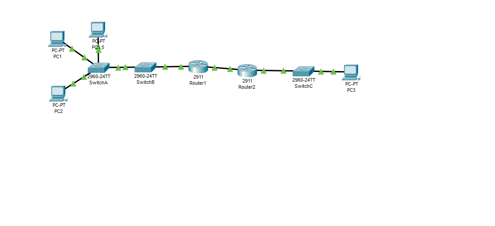

# Lab 01 — Enterprise Network Design and Routing Verification

**Author:** Melih Mert Kaya  
**Platform:** Cisco Packet Tracer  
**Stage:** Baseline documented; Pre-ACL baseline snapshot (ACL implemented separately in Lab 02)

## Objective

Document an existing multi-router Packet Tracer topology, verify VLAN gateway interfaces and static routing, and establish a connectivity baseline before introducing access controls.

## Topology

The screenshot shows **four PCs, three switches, and two routers**. The observed layout is PC1/PC2/PC4 through SwitchA and SwitchB to Router1, then Router2 through SwitchC to PC3. Exact PC-to-VLAN assignments require switch and host configuration verification.

## Addressing and routing — observed

| Device/interface or network | Address | Evidence |
| --- | --- | --- |
| Router1 Gi0/0.10 | 10.10.10.254/24 | Router1 CLI screenshots |
| Router1 Gi0/0.20 | 192.168.1.254/24 | Router1 CLI screenshots |
| Router1 Gi0/1 | 192.168.100.1/30 | Router1 CLI screenshots |
| Router2 next hop | 192.168.100.2 | Router1 static route and successful ping; verify interface config separately |
| Remote network | 172.16.10.0/24 | Router1 static route, Router2 route table |
| PC3 | 172.16.10.1 | Address reported during lab |

Router1 subinterfaces show `encapsulation dot1Q 10` and `encapsulation dot1Q 20`. The Router1 static route to `172.16.10.0/24` points to `192.168.100.2`. Router2's route table shows static routes back to `10.10.10.0/24` and `192.168.1.0/24` via `192.168.100.1`.

## Baseline verification

| Test | Reported result | Documentation note |
| --- | --- | --- |
| Router1 → 192.168.100.2 ping | Success | User reported success; full terminal output not saved |
| PC1 → 172.16.10.254 ping | Success | User reported success; full terminal output not saved |
| PC1 → PC3 (172.16.10.1) ping | Success | User reported success; full terminal output not saved |

The tests indicate reachability at the time of testing. They do not independently establish all switch VLAN assignments or prove that ACLs are present.

## Security phase — not implemented

**Proposed requirement:** Block traffic initiated from VLAN 10 (`10.10.10.0/24`) toward VLAN 20 (`192.168.1.0/24`), while retaining authorized access to the remote network (`172.16.10.0/24`). Before applying an ACL, confirm which PCs belong to which VLANs and capture pre-change tests.

Planned checks: ACL attachment and direction; blocked/allowed ping tests; `show ip access-lists` counters; verification of unaffected traffic. See [security plan](security-plan.md).

## Evidence and files

- [`network.pkt`](network.pkt) — original Packet Tracer project, copied without modification
- [`topology.png`](topology.png) — screenshot of the existing topology
- [`evidence/router1-interfaces.png`](evidence/router1-interfaces.png) — Router1 interface summary
- [`evidence/router1-running-config.png`](evidence/router1-running-config.png) — Router1 running configuration screenshot
- [`evidence/router2-routing-table.png`](evidence/router2-routing-table.png) — Router2 routing table screenshot
- [`test-results.md`](test-results.md) — baseline test log and evidence limitations
- [`configurations/README.md`](configurations/README.md) — configuration extraction status

## Next steps

1. Verify switch VLAN membership and trunk ports using `show vlan brief` and `show interfaces trunk`.
2. Capture PC1/PC3 IP configuration and baseline test screenshots.
3. Save a backup of the Packet Tracer project before modifying ACLs.
4. Apply and verify a narrowly scoped extended ACL on Router1.
5. Record before/after results and update the lab status.
