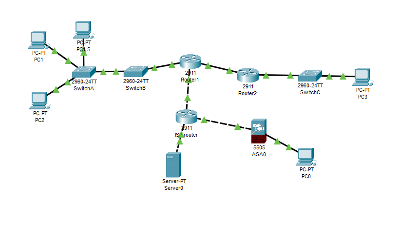

# Enterprise Network & Security Engineering Labs

**Cisco Packet Tracer | Hands-on Networking & Security Portfolio**

A progressive series of simulated enterprise-network labs covering VLAN segmentation, routing, access control, DHCP, NAT/PAT, and Cisco ASA firewall fundamentals. Each lab builds on the previous topology and documents configurations, validation results, troubleshooting, and lessons learned.

> **Environment:** Cisco Packet Tracer. All networks and servers are simulated; this is not a live internet connection or a production deployment.

## Lab Progress

| Lab | Topic | Work performed | Verification |
| --- | --- | --- | --- |
| **LAB 01** | Enterprise Routing & VLANs | VLAN 10/20/30, trunking, router-on-a-stick, inter-VLAN and static routing | Baseline connectivity tested |
| **LAB 02** | Extended ACL | Applied `BLOCK_VLAN10_TO_VLAN20` inbound on Router1 VLAN 10 subinterface | VLAN 10 → VLAN 20 blocked; permitted paths tested |
| **LAB 03** | DHCP & NAT/PAT | DHCP for two VLANs, ISP simulation, router-based PAT | DHCP assignments and NAT translations observed |
| **[LAB 04](LAB-04-ASA-Firewall/README.md)** | Cisco ASA 5505 Firewall | Added ASA inside/outside zones, default route and Dynamic PAT; diagnosed addressing errors | Inside PC → ASA **PASS**; outside reachability **UNRESOLVED** |

## Network Evolution

**LAB 01:** Built the enterprise network foundation with VLANs, routing and end hosts.  
**LAB 02:** Introduced traffic restrictions using an extended ACL.  
**LAB 03:** Added automatic host addressing and NAT/PAT through a simulated ISP.  
**LAB 04:** Added a Cisco ASA 5505 firewall and a dedicated inside test PC without replacing the earlier network components.

## Latest Topology — LAB 04

## Skills Practiced

- VLANs, 802.1Q trunks, router-on-a-stick and static routing
- Extended ACLs and traffic filtering
- DHCP pools and client address verification
- NAT/PAT configuration and translation checks
- ASA logical VLAN interfaces, inside/outside zones and security levels
- Troubleshooting with `ping`, `ipconfig`, `show route`, `show nat` and `show xlate`
- Accurate reporting of both successful tests and unresolved issues

## Tools

Cisco Packet Tracer · Cisco IOS CLI · Cisco ASA 5505 CLI

## Notes

- IP addresses are lab addresses, not public production services. `203.0.113.0/24` and `198.51.100.0/24` are documentation networks; `198.18.0.0/15` is reserved for benchmarking/testing.
- **LAB 04 is partially completed:** a configured NAT rule and default route do not prove successful end-to-end forwarding.
- The LAB 04 folder in this update contains the actual topology image and its report. Existing LAB 01–03 folders should remain unchanged in your GitHub repository.
- Packet Tracer `.pkt` files should be uploaded separately when available; this package does not invent or replace a project file.

## Next Steps

1. Diagnose ASA traffic forwarding and return-path handling.
2. Verify end-to-end traffic and NAT translations.
3. Add a DMZ and validate its access restrictions in a future lab.
